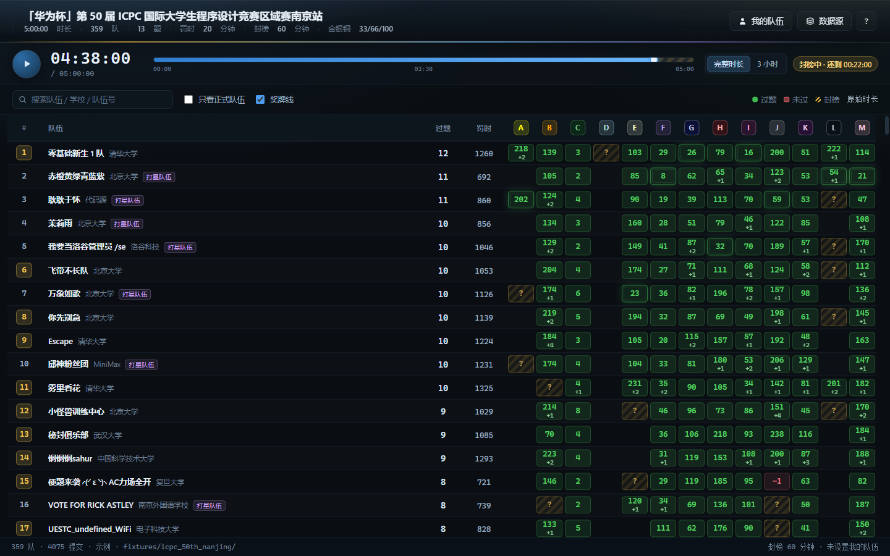
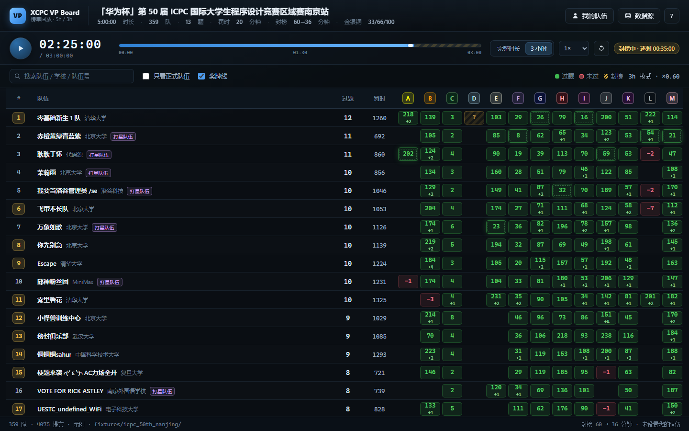

# VP Board Better · 虚拟榜单回放

把一场 XCPC / ICPC 比赛的真实榜单数据当成录像回放：时间轴可以拖动、加速、暂停，榜单按时间点实时重算。

除了标准的 5 小时 VP，还可以把整场比赛**等比例压缩成 3 小时**——原本第 5 小时才通过的题，会在第 3 小时出现在榜单上。

3 小时模式（时间轴与封榜等比例压缩）

## 两种时长

| 模式 | 时间轴 | 封榜 | 用途 |
| --- | --- | --- | --- |
| 完整时长 | 与比赛原始时长 1:1 | 与原始封榜时间一致 | 标准 5 小时 VP |
| 3 小时 | 按 `3h ÷ 原时长` 等比例压缩（5h 比赛 = ×0.6） | 同步压缩（原 60 分钟 → 36 分钟） | 个人 3 小时 VP |

3 小时模式下，格子里显示的仍然是**原始比赛时间与原始罚时**，鼠标悬停可以看到换算后实际出现在第几分钟，以及按压缩时间算的罚时。

## 怎么启动

双击 **`VPBoardBetter.exe`**（会弹一次 UAC：需要管理员权限，否则 Windows 的工作区限制会让窗口白屏）。

不想用 exe 就双击 `start.bat`，行为一样。关掉服务用 `stop.bat`。

## 加载一场比赛

打开后点「数据源」：

- 点「选择榜单」，从 XCPCIO 的比赛列表里按名字 / 城市 / 路径搜，点一行自动填好；
- 或者直接粘贴榜单链接、路径，例如 `https://board.xcpcio.com/icpc/50th/nanjing`、`icpc/50th/nanjing`；
- 或者把 `config.json`、`team.json`、`run.json` 三个文件拖进窗口。

同一个弹窗里还有一行「这场比赛对应的 QOJ 比赛」——想在页面里直接交题就填上这一场的 QOJ 链接（也可以点「选择比赛」从 QOJ 列表里挑，或只填 `4597`）。填一次就记在这一场上，换比赛换链接。

## 时间轴

| 操作 | 快捷键 |
| --- | --- |
| 播放 / 暂停 | `空格` |
| 后退 / 前进 1 分钟 | `←` / `→`（按住 `Shift` = 5 分钟） |
| 从头开始 | `R` |
| 聚焦搜索框 | `/` |
| 关闭弹窗 / 抽屉 | `Esc` |

拖动进度条任意跳转；右侧「完整时长 / 3 小时」随时切换；倍速 0.5×–8×。

走到封榜时刻会出现「封榜中」徽标与倒计时，时间轴末段斜纹区就是封榜区，长度随模式缩放；到终点自动揭榜。

## 榜单

- 排名：过题数降序 → 罚时升序 → 最后过题时间升序 → 队名。
- 罚时：每题首次通过的比赛时间 + 20 分钟 × 该题此前的失败次数。编译错误（CE）不计罚时、也不占格子。
- 一血格有虚线内框；封榜期内未揭晓的格子显示 `?`，鼠标悬停可以看已记录的失败次数。
- 可以搜索队伍 / 学校 / 队号，勾选「只看正式队伍」过滤打星队，勾选「奖牌线」显示金银铜分界。
- 点任意队伍打开详情：名次、过题、罚时、每题通过时刻、队员与教练、提交记录。

## 我的队伍

点右上「我的队伍」：

- **创建我的队伍**：不用填任何信息，直接以「我 · 本机」的身份插进榜单，按你记录的提交实时计算；
- **从已有队伍中选择**：直接高亮你在榜单里的那支队，再给它补记你自己的提交。

之后点「记录提交」，选题目、AC / 失败 / 编译错误、提交时间（默认当前时刻，格式 `分:秒`），榜单立刻更新。记录保存在本机浏览器里。

## QOJ 交题（可选）

设好「我的队伍」之后，点「提交到 QOJ」：选 A/B/C 题号、贴代码、提交。页面会显示评测状态，评测结束自动按**当前榜单时间**记成一次提交。

第一次用需要在弹窗里填一次 QOJ 账号密码登录（密码只在内存里，不落盘；登录态只保存 cookie，下次不用再登）。

## 常见问题

- **双击 exe 后白屏**：没有以管理员身份运行。右键「以管理员身份运行」，或改用 `start.bat`。
- **直接双击 `index.html` 取不到数据**：部分网络环境不允许浏览器跨域访问 `board.xcpcio.com`，用 exe / `start.bat` 启动，或改用本地文件。
- **QOJ 登录卡住**：网络到 Cloudflare 的验证没过去，点「提交到 QOJ」里的「诊断日志」看卡在哪一步，再重试一次。

## 数据来源

榜单数据来自 [XCPCIO board](https://board.xcpcio.com) 与 [xcpcio/board-data](https://github.com/xcpcio/board-data)，自动兼容新旧两种数据格式。示例数据是 2025 ICPC 南京站（359 队 / 4075 次提交）。

## 许可

[MIT](LICENSE)

开发、构建与实现细节见 [docs/DEVELOPMENT.md](docs/DEVELOPMENT.md)。
